  

<a href="assets/prismtek-ascii.txt">View the plain ASCII version</a>

# Prismtek

**Public game tools, addons, and companion projects from Prismtek.**

[Website](https://prismtek.dev) · [Project issues](https://github.com/codysumpter-cloud/prismtek/issues) · [Contribution guide](CONTRIBUTING.md) · [Publishing policy](docs/PUBLISHING.md)

Prismtek builds practical tools for players and creators: less searching, clearer guidance, and more time enjoying games. This is our **public-facing project repository**, separate from the private codebase that powers prismtek.dev.

## Projects

### Armory Buddy — World of Warcraft

Armory Buddy is a work-in-progress player companion and addon initiative. Its direction includes personalized progression guidance, gear and profession recommendations, and discoverable addon-related information.

**Status: in development.** This repository does not currently contain a released, installable Armory Buddy addon or a working CurseForge integration. Features described here are goals, not shipped functionality. See [the project page](projects/armory-buddy/README.md).

### More Prismtek tools

We plan to use this repo for approved public addons, companion utilities, documentation, and source releases for additional games. Each published project will state its game/version support, release status, author credits, and specific license.

## Repository map

| Location | Contents |
| --- | --- |
| [projects/armory-buddy](projects/armory-buddy/README.md) | Armory Buddy overview and status |
| [docs/PUBLISHING.md](docs/PUBLISHING.md) | Public-release and third-party content checklist |
| [CONTRIBUTING.md](CONTRIBUTING.md) | Contribution rules |
| [SECURITY.md](SECURITY.md) | Private vulnerability reporting |
| [LICENSE](LICENSE) | Default copyright and licensing policy |

## Respecting creators and platforms

We want to **send players toward the people making great mods**, credit original authors, and link to their official project and support pages.

- We will not mirror or distribute third-party mod files without the necessary permissions.
- CurseForge API access or distribution rights are **not implied by this repository**. Any integration must comply with current provider terms and the scope of its approval.
- API keys, secrets, private account information, and proprietary internal source code must never be committed here.
- Game names and third-party trademarks belong to their respective owners. Prismtek is an independent project, not affiliated with or endorsed by Blizzard, CurseForge, or other game companies.

## Sustainability

We intend to keep core player-facing addons accessible. Prismtek may support development through optional donations, ads, sponsorships, or paid features in our **own** companion services, subject to applicable platform policies. This is a future-facing model, not a claim that any monetization or partnership is active. Third-party files will not be resold or put behind a paywall without authorization.

## Get involved

Open an [issue](https://github.com/codysumpter-cloud/prismtek/issues) to suggest a feature or report a public bug. Read [CONTRIBUTING.md](CONTRIBUTING.md) before proposing source changes. Please do **not** publish exploit details or secrets in issues; see [SECURITY.md](SECURITY.md).

## Licensing

**Public visibility is not the same as open-source licensing.** By default, the material in this umbrella repository is rights-reserved. Individual future code or asset releases can be made MIT, Apache-2.0, GPL, CC0, or another appropriate license **only when explicitly marked**; third-party materials keep their own terms. See [LICENSE](LICENSE) and [docs/PUBLISHING.md](docs/PUBLISHING.md).

© 2026 Cody Sumpter / Prismtek.
